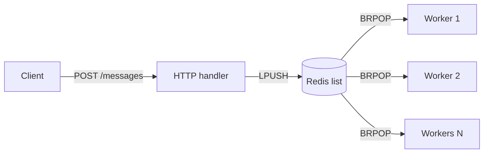

# message-queue

A small message queue I built in Go to learn how producers, queues and consumers work together.

You send a message to an HTTP endpoint, it gets pushed into a Redis list, and a few goroutines pick messages up from the other end and process them in the background.



The endpoint replies `202 Accepted` as soon as the message is in Redis, it doesn't wait for the processing to finish.

## How to run it

You need Go and Redis.

Start Redis :

```bash
redis-server
```

Then run the server:

```bash
go mod tidy
go run ./cmd/server
```

It listens on `localhost:8080`. Send a message like this:

For sending single message.

```bash
curl -X POST localhost:8080/messages \
  -H "Content-Type: application/json" \
  -d '{"id":1,"message":"hello"}'
```

This is for multiple messages .

```bash
for i in $(seq 1 20); do
  curl -s -X POST localhost:8080/messages \
    -H "Content-Type: application/json" \
    -d "{\"id\":$i,\"message\":\"msg $i\"}" > /dev/null
done
```

Test bad requests

```bash
curl -i localhost:8080/messages                                        # 405
curl -i -X POST localhost:8080/messages -d 'not json'                  # 400
curl -i -X POST localhost:8080/messages \
  -H "Content-Type: application/json" -d '{"id":0,"message":""}'      # 400
```

You'll see the consumer pick it up in the server logs.

## Project layout

```
cmd/server        starts everything
internal/producer the HTTP handler
internal/queue    talks to Redis
internal/consumer the worker goroutines
```

## Known limitations

This is a learning project, not something to run in production. The main catch is that a message is removed from Redis the moment a consumer takes it, so if the program crashes halfway through processing, that message is lost. Acknowledgements are next on my list.

## Roadmap

I want to build the same queue a few different ways to compare them: channels, a ring buffer, an append-only log, an embedded database, and then Redis (what's here now).
